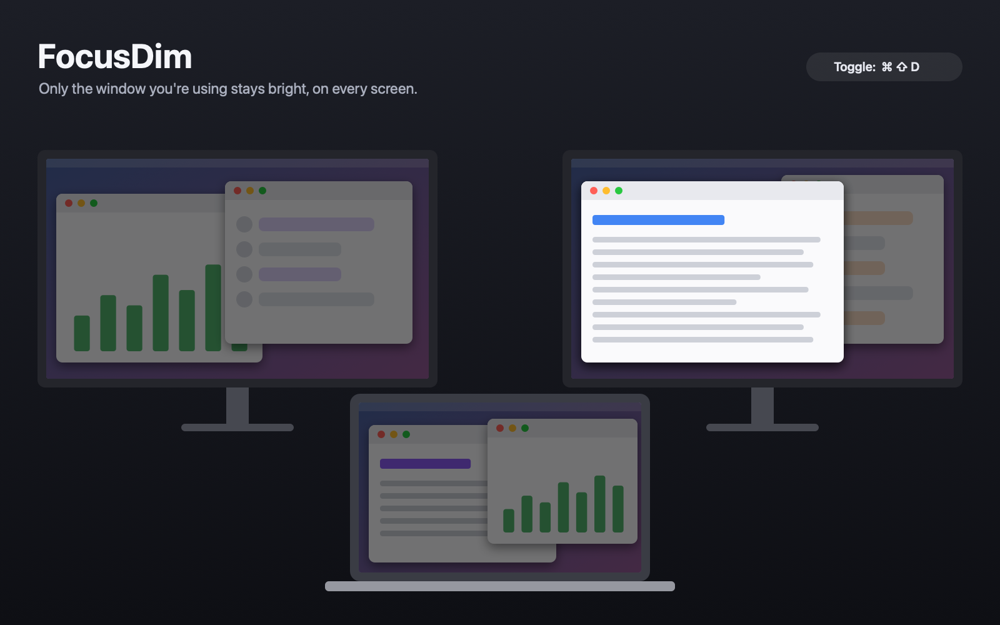

# FocusDim

A tiny, free macOS menu bar app that dims every window except the one you are working in. It works across all your screens, so with a MacBook and two external monitors only the focused window stays bright.

Inspired by [HazeOver](https://hazeover.com/).



## Features

- Dims every window except the focused one, on every connected display
- Works with any app, including full-screen windows and Spaces
- Toggle with **⌘⇧D** (Command + Shift + D) from any app
- Menu bar icon: half-filled circle = on, empty circle = off, exclamation mark = needs Accessibility access
- Adjustable dim level (slider in the menu)
- Starts automatically at login (can be turned off in the menu)
- Single Swift file, no dependencies

## Easy install (no Terminal needed)

1. Download **[FocusDim.dmg](https://github.com/NikRpk/FocusDim/releases/latest/download/FocusDim.dmg)**.
2. Open the downloaded file. Drag **FocusDim** onto the **Applications** folder.
3. Open your **Applications** folder and double-click **FocusDim**.
4. macOS will say it can't check the app, because FocusDim is free and not registered with Apple. Click **Done** (not "Move to Trash").
5. Open **System Settings → Privacy & Security**. Scroll down and click **Open Anyway** next to FocusDim. Confirm with your password or Touch ID.
6. macOS asks for **Accessibility** access. Click **Open System Settings** and turn on **FocusDim**.

Done. A half-filled circle appears in the menu bar. Press **⌘⇧D** (Command + Shift + D) to turn dimming on or off. FocusDim starts by itself every time you start your Mac.

Steps 4 and 5 are only needed the first time.

## Build from source

- macOS 13 (Ventura) or later
- Xcode Command Line Tools (for `swiftc`): `xcode-select --install`

## Install

```sh
git clone https://github.com/NikRpk/FocusDim.git
cd FocusDim
./build.sh
open ~/Applications/FocusDim.app
```

`build.sh` compiles the app, signs it locally, and installs it to `~/Applications/FocusDim.app`. Keep it there: the login item points to that location.

On first launch:

1. macOS asks for **Accessibility** access. Click **Open System Settings** and turn on **FocusDim**. FocusDim needs this to ask macOS which window is focused (the same information VoiceOver uses). It does not read window contents or keystrokes.
2. FocusDim adds itself as a login item. macOS may show a one-time "Login item added" notice.

## Use

| Action | How |
|---|---|
| Turn dimming on/off | Press **⌘⇧D**, or click the menu bar icon → **Dim other windows** |
| Change how dark | Menu bar icon → **Dim level** slider |
| Start at login on/off | Menu bar icon → **Start at login** |
| Quit | Menu bar icon → **Quit FocusDim** |

Settings are remembered between restarts.

## Update

```sh
cd FocusDim
git pull
./build.sh
open ~/Applications/FocusDim.app
```

Each build has a new local signature, so macOS forgets the Accessibility permission. `build.sh` clears the old entry; turn FocusDim on again when macOS asks.

## Uninstall

1. Menu bar icon → untick **Start at login**, then **Quit FocusDim**
2. Delete **FocusDim** from your Applications folder (or `~/Applications/FocusDim.app` if you built it yourself)
3. Optional: remove FocusDim from System Settings → Privacy & Security → Accessibility

## Make the installer

`./release.sh` builds `dist/FocusDim.dmg`: a universal app (Apple silicon and Intel, macOS 13+) on a disk image with an Applications shortcut. Upload it to a GitHub release:

```sh
./release.sh
gh release create v1.0 dist/FocusDim.dmg --title "FocusDim 1.0"
```

The app is signed locally, not with a paid Apple Developer ID, which is why first-time users need **Open Anyway** (step 5 of Easy install).

## How it works

1. **Which window is focused?** FocusDim asks macOS through the Accessibility API for the frontmost app's focused window. It does not guess from window sizes or stacking order.
2. **Two click-through dim layers per screen:**
   - *Cover* floats above all normal windows and dims the whole screen. It is used on screens that do not show the focused window.
   - *Under* sits directly below the focused window in the window stack. It is used on screens that show the focused window (both screens if the window spans two).

   Full-screen apps: macOS keeps FocusDim's layers above a full-screen app and won't put them below it. macOS reports full screen for each window (the `AXFullScreen` attribute), so on that screen the under layer stays off. Nothing is behind a full-screen app anyway.
3. **Self-check.** On every update FocusDim compares the real window stack with what it expects. If anything slipped between the focused window and the under layer (Space switches, new windows), it fixes the order. If it can't, the under layer stays off: the focused window is never dimmed.
4. **When it updates:** on focus, move, resize and new-window events from the focused app, on app and Space switches, and every 0.25 seconds as a safety check.

If the focused window can't be found (for example when you click the desktop), nothing is dimmed.

## Known limits

- **⌘⇧D** is taken over globally while FocusDim runs, so apps that use the same shortcut won't receive it. Change it in `registerHotKey()` in `main.swift`.
- Floating panels (always-on-top windows) on the focused screen are not dimmed.

## License

MIT
